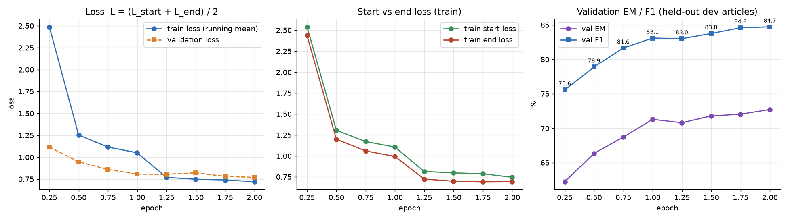
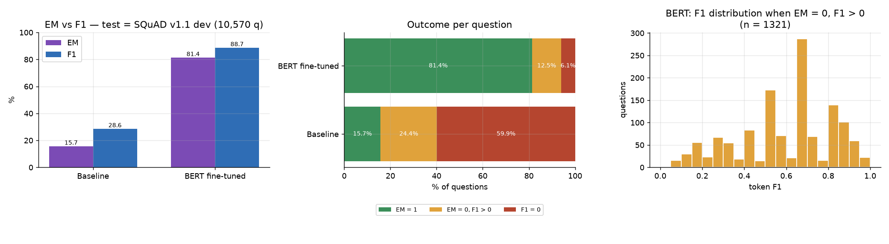
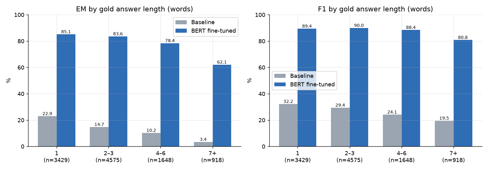

# Lab 10 — Extractive Question Answering

Bài thực hành môn Xử lý Ngôn ngữ Tự nhiên (NLP) — ĐHKHTN - ĐHQGHN.
Chủ đề: **From Token Classification to Span Prediction**: fine-tune `bert-base-cased` trên SQuAD v1.1 để dự đoán `(start, end)` của câu trả lời trong context.

---

## 1. Danh mục sản phẩm (Deliverables — Mục 31)

```
lab10/
├── README.md                    # Tổng quan, kết quả, reproducibility, learning check, AI usage
├── calculations.md              # Bài tập tính toán 1–3, QA loss, token-level F1 tự tính
├── prediction.md                # 4 dự đoán trước thực nghiệm + đối chiếu sau thực nghiệm
├── tokenizer_alignment.ipynb    # input_ids / attention_mask / token_type_ids / offset_mapping / stride (đã chạy)
├── qa_model.py                  # Lõi: sliding window, căn chỉnh char→token, start/end loss, decoding, EM/F1, training
├── qa_finetuning.ipynb          # Learning curves, kết quả, thực nghiệm, suy luận (đã chạy)
├── results.csv                  # Baseline vs Transformer + Experiment 1 (context length)
├── learning_curves.png          # Train/val loss, start/end loss, val EM/F1
├── em_f1_analysis.png           # EM vs F1, phân bố kết quả, F1 của các câu EM = 0
├── answer_length_analysis.png   # EM/F1 theo độ dài đáp án (Experiment 5)
├── error_analysis.md            # Wrong start / wrong end / wrong span, EM=0 & F1>0, lexical overlap
├── document_qa.py               # Ứng dụng mini Document QA
├── reflection.md                # Reflection LAB 08 – 09 – 10
│
├── baseline_qa.py               # (bổ sung) Baseline keyword-overlap + answer-type rules
├── analyze_qa.py                # (bổ sung) Sinh results.csv, các biểu đồ, phân tích lỗi, robustness
├── build_notebooks.py           # (bổ sung) Sinh 2 notebook
└── outputs/                     # (bổ sung) summary/history của từng run, analysis.json, error_samples.json,
                                 #           document_qa_demo.txt  (checkpoint & predictions chỉ lưu trên server22)
```

---

## 2. Reproducibility (Mục 30)

| Mục | Giá trị |
|:--|:--|
| Model | `bert-base-cased` + `AutoModelForQuestionAnswering` (Linear 768 → 2: start/end logits) |
| Tokenizer | `bert-base-cased` WordPiece (fast tokenizer, có `offset_mapping`) |
| Dataset | SQuAD v1.1 (`rajpurkar/squad`) |
| Train split | SQuAD-train trừ các bài dev → **85,579** câu hỏi (86,696 window) |
| Validation split | **2,020** câu hỏi từ 10 bài Wikipedia (Glacier, IBM, Kathmandu, Paper, …) tách khỏi SQuAD-train **theo title** (không rò rỉ bài viết); dùng cho learning curves |
| Test split | SQuAD v1.1 **dev chính thức** — **10,570** câu hỏi (10,822 window), có 3+ gold/câu |
| Max sequence length | 384 (Experiment 1: 128 / 256 / 384) |
| Stride (overlap) | 128 (Experiment 1: `max_length // 3` = 42 / 85 / 128) |
| Truncation | `only_second` + `return_overflowing_tokens=True` (sliding window) |
| Batch size | 8 × gradient accumulation 2 = **16** hiệu dụng; eval batch 64 |
| Learning rate | 3e-5, linear decay, warmup 10% |
| Epochs | 2 (Experiment 1: 1 epoch trên 20,000 câu hỏi) |
| Optimizer | AdamW (weight decay 0.01, không decay bias/LayerNorm), grad clip 1.0, mixed precision fp16 |
| Loss | $L = (CE_{start} + CE_{end}) / 2$, softmax trên vị trí — viết tường minh trong `qa_loss()` |
| Decoding | n-best = 20 start × 20 end, ràng buộc $i \le j$, độ dài ≤ 30 token, chỉ token thuộc context, max qua các window |
| Random seed | 42 |
| Hardware | `server22` — NVIDIA GeForce RTX 3060 12GB (dùng chung với job khác), Python 3.12, PyTorch 2.6 + CUDA 12.6, Transformers 5.23, Datasets 5.2 |
| Training time | **76.9 phút** (model chính, 10,838 optimizer steps, chưa tính thời gian eval) |

---

## 3. Kết quả thực nghiệm

### 3.1. Experiment 2 — Fine-tuning & learning curves



| Epoch | Train loss | Val loss | Val EM | Val F1 |
|:-:|:-:|:-:|:-:|:-:|
| 0.25 | 2.488 | 1.118 | 62.23 | 75.57 |
| 0.50 | 1.254 | 0.948 | 66.34 | 78.89 |
| 0.75 | 1.116 | 0.860 | 68.71 | 81.65 |
| 1.00 | 1.051 | 0.807 | 71.29 | 83.09 |
| 1.25 | 0.770 | 0.804 | 70.79 | 83.00 |
| 1.50 | 0.748 | 0.822 | 71.78 | 83.76 |
| 1.75 | 0.740 | 0.781 | 72.03 | 84.59 |
| 2.00 | 0.720 | 0.769 | 72.72 | 84.73 |

- Loss khởi điểm ≈ 5.6, gần $\ln 384 = 5.95$ (phân phối đều trên 384 vị trí — xem `calculations.md`).
- Phần lớn việc học diễn ra trong 1/4 epoch đầu (F1 75.6). Sang epoch 2, train loss giảm đột ngột (1.05 → 0.77) nhưng val loss gần như đứng yên (0.81 → 0.77): model bắt đầu ghi nhớ tập train. Thêm epoch thứ 3 khó mang lại cải thiện đáng kể.
- **Start loss luôn cao hơn end loss** (0.78 vs 0.69 ở cuối) — khớp với việc wrong start nhiều hơn wrong end trong phân tích lỗi.
- Val F1 (84.7) thấp hơn test F1 (88.7) vì tập val tách từ SQuAD-train chỉ có **1 gold**/câu, còn SQuAD dev có 3+ gold và EM/F1 lấy **max** trên các gold.

### 3.2. Experiment 3 — Baseline vs Transformer, EM vs F1 (test, 10,570 câu hỏi)

| Model | EM | F1 | F1 − EM |
|:--|:-:|:-:|:-:|
| Baseline (keyword overlap → câu ứng viên → span theo kiểu câu hỏi) | 15.71 | 28.63 | 12.92 |
| **`bert-base-cased` fine-tuned** | **81.40** | **88.73** | 7.33 |



- BERT vượt baseline **+65.7 EM / +60.1 F1**. Trên 10,570 câu hỏi: 7,063 câu chỉ BERT đúng (EM), 1,541 câu cả hai cùng đúng, chỉ **120** câu baseline đúng còn BERT sai. Model thực sự dùng tương tác question/context chứ không chỉ khớp từ khóa.
- 1,321 câu (12.5%) có **EM = 0 nhưng F1 > 0** — các prediction lệch biên một vài từ. Phân tích chi tiết + ví dụ: `error_analysis.md` §3.

### 3.3. Experiment 1 — Context length

Thiết lập chung: 20,000 câu hỏi train (cùng seed), 1 epoch, `stride = max_length // 3`, batch hiệu dụng 16, lr 3e-5. Đánh giá trên toàn bộ test (10,570 câu hỏi). Dev là 2,020 câu hỏi held-out.

| max_length | stride | Window / ví dụ | % window train chứa đáp án | Train features (= số bước × 16) | Dev F1 | Test EM | Test F1 | Train time |
|:-:|:-:|:-:|:-:|:-:|:-:|:-:|:-:|:-:|
| 128 | 42 | 2.22 | 54.4% | 44,328 (2,771 bước) | 76.73 | **73.30** | **81.92** | 10.8 phút |
| 256 | 85 | 1.12 | 91.2% | 22,448 (1,403 bước) | **77.07** | 72.35 | 81.67 | 7.6 phút |
| 384 | 128 | 1.01 | 99.0% | 20,253 (1,266 bước) | 75.65 | 71.89 | 81.18 | 9.5 phút |

**Nhận xét:**
- Ba cấu hình chênh nhau **dưới 0.8 điểm F1**, nhỏ hơn nhiều so với dự đoán "+3–6 F1 khi đi từ 128 lên 256" trong `prediction.md`. Ở cùng số câu hỏi, sliding window với stride bù gần như hoàn toàn cho window ngắn. Lúc suy luận, đáp án nào bị cắt ở window này thì vẫn nằm trọn trong window chồng lấn kế bên (audit trong `tokenizer_alignment.ipynb`: 100% đáp án nằm trọn trong ít nhất một window, kể cả ở 128).
- Thứ tự 128 > 256 > 384 trên test **không** có nghĩa context ngắn tốt hơn. So sánh này không cân bằng: với 128, mỗi câu hỏi sinh 2.2 window, nên model được cập nhật **2.2× nhiều bước** hơn trong 1 epoch. Hơn nữa, 45.6% window không chứa đáp án và có target là `[CLS]`. Đây là các mẫu dễ, kéo train loss xuống thấp (0.30 so với 1.39 ở 384), nhưng chúng cũng dạy model "từ chối" ở window sai. Điều này có ích khi tổng hợp kết quả qua nhiều window. Trên dev, 256 lại nhỉnh nhất (77.07), nên thứ hạng giữa ba cấu hình nằm trong mức nhiễu.
- Window ngắn có cái giá thật ở **chi phí suy luận**: test có 24,295 feature ở 128, so với 10,822 ở 384 (gấp 2.2×), và model mất ngữ cảnh xa khi câu hỏi cần thông tin ở câu khác. Thời gian train không tỷ lệ với độ dài: 128 chạy nhiều bước nhất nên lâu nhất, đúng với dự đoán về chi phí. GPU dùng chung với người khác nên thời gian chỉ mang tính tham khảo.
- Kết luận: với SQuAD (context trung bình ~168 token), `max_length = 384, stride = 128` là lựa chọn hợp lý cho model chính. Lý do là ít window nhất và gần như mọi window chứa đáp án, chứ không phải vì độ chính xác cao hơn. Với văn bản dài (xem `document_qa.py`), sliding window là cơ chế bắt buộc.

### 3.4. Experiment 4 — Question/context lexical matching

| Nhóm overlap (câu hỏi ↔ câu chứa đáp án) | n | BERT EM | BERT F1 | Baseline F1 |
|:--|--:|:-:|:-:|:-:|
| High (≥ 0.80) | 2,847 | 87.43 | 93.53 | 40.05 |
| Middle | 4,767 | 82.90 | 89.93 | 29.76 |
| Low (≤ 0.40) | 2,956 | 73.17 | 82.19 | 15.80 |

BERT mất **11.3 điểm F1** khi câu hỏi được diễn đạt khác với câu chứa đáp án: có phụ thuộc vào lexical overlap, nhưng vẫn giữ F1 82 so với 16 của baseline.

### 3.5. Experiment 5 — Answer length

| Answer length (từ) | n | EM | F1 | F1 − EM |
|:--|--:|:-:|:-:|:-:|
| 1 | 3,429 | 85.13 | 89.37 | 4.24 |
| 2–3 | 4,575 | 83.56 | 89.96 | 6.40 |
| 4–6 | 1,648 | 78.40 | 88.42 | 10.02 |
| 7+ | 918 | 62.09 | 80.81 | 18.72 |



EM giảm 23 điểm từ nhóm 1 từ sang nhóm 7+, F1 chỉ giảm 8.6 điểm: answer dài bị **lệch biên** chứ không bị tìm sai vị trí.

### 3.6. Robustness — kiểm tra Prediction 3 & 4 (1,000 câu hỏi test ngẫu nhiên)

| Điều kiện | Windows/câu | BERT EM | BERT F1 | ΔF1 | Baseline F1 |
|:--|:-:|:-:|:-:|:-:|:-:|
| Original | 1.017 | 81.8 | 90.05 | – | 32.00 |
| + đoạn văn không liên quan (nối **sau**) | 1.309 | 81.0 | 88.88 | −1.2 | 32.00 |
| + đoạn văn không liên quan (chèn **trước**) | 1.309 | 78.4 | 86.72 | −3.3 | 31.69 |
| Xáo trộn thứ tự câu | 1.017 | 79.5 | 88.75 | −1.3 | 32.05 |
| + câu distractor kiểu AddSent (đổi tên riêng/số, nối sau) | 1.020 | 42.9 | 47.18 | **−42.9** | 16.95 |
| + câu distractor mâu thuẫn (chép nguyên câu hỏi + đáp án giả) | 1.020 | 29.4 | 32.47 | **−57.6** | 8.44 |

- Thông tin **không liên quan** chỉ làm giảm nhẹ (1–3 F1), đúng Prediction 3. Chèn đoạn lạ **trước** gây hại nhiều hơn nối sau, vì đáp án bị đẩy ra xa đầu chuỗi và có thể rơi vào window thứ hai.
- **Distractor có nhiều từ trùng với câu hỏi** làm model sụp đổ (39.5% câu đang đúng bị lật sai). Mức giảm lớn hơn nhiều so với dự đoán 10–20 F1. Lưu ý: distractor ở đây được đặt **cuối** context và chép gần như nguyên văn câu hỏi, nên mạnh hơn AddSent gốc (vốn còn đổi cả tính từ/danh từ). Biến thể "mâu thuẫn" thực chất cung cấp một câu trả lời hợp lệ về mặt chữ, nên đó là kiểm tra mức độ ưu tiên lexical match chứ không hẳn là lỗi của model.
- **Xáo trộn câu** chỉ giảm 1.3 F1, đúng Prediction 4: model chủ yếu dựa vào khớp cục bộ question ↔ câu.

### 3.7. Document QA (`document_qa.py`)

Tài liệu demo (4 đoạn về Transformer/BERT/SQuAD, 400 token → 2 window). Model trả lời đúng 9/9 câu hỏi có đáp án, kể cả câu diễn đạt khác ("Which company developed BERT?" → *Google*; "Who wrote the SQuAD questions?" → *crowdworkers*). Với câu hỏi **không có đáp án** ("Who won the 2018 FIFA World Cup?"), model vẫn trả về *Google* nhưng với score **−9.8**, trong khi các câu có đáp án đạt score +7 đến +20. Ngưỡng trên score có thể giúp phát hiện no-answer một cách thô sơ, còn giải pháp đúng là huấn luyện trên SQuAD 2.0 (Mục 26). Toàn bộ output: `outputs/document_qa_demo.txt`.

---

## 4. Individual Learning Check (Mục 33)

1. **Extractive QA khác classification như thế nào?**
   Classification đọc vector `[CLS]` và chọn 1 trong C nhãn cố định; output không phụ thuộc vị trí. Extractive QA đọc vector của **mọi token** và chọn **vị trí** trong chính input: số "lớp" bằng độ dài chuỗi và thay đổi theo từng mẫu. Input cũng là một **cặp** (question, context), không phải một văn bản.
2. **Tại sao QA cần start và end position?**
   Câu trả lời là một đoạn liên tiếp có độ dài thay đổi, cần đủ hai biên để xác định. Một phân phối duy nhất chỉ chọn được 1 token; phân loại trực tiếp mọi span cần $T(T+1)/2$ lớp (73,920 với T = 384). Tách thành start/end chỉ cần $2T$ logits, rồi chọn $\arg\max_{i \le j} s_i + e_j$ lúc giải mã.
3. **Character offset khác token index như thế nào?**
   Character offset là vị trí ký tự trong chuỗi context gốc (đơn vị của `answer_start` trong dataset). Token index là vị trí trong chuỗi `input_ids` sau tokenization, bao gồm `[CLS]`, các token câu hỏi và `[SEP]`. Ví dụ "Paris": ký tự 25–30 nhưng token 14.
4. **Tại sao cần offset mapping?**
   Đây là cầu nối duy nhất giữa hai hệ chỉ số. Lúc **huấn luyện**, nó chuyển `answer_start` (ký tự) thành `start_positions`/`end_positions` (token). Lúc **suy luận**, nó chuyển `(start_token, end_token)` thành đoạn ký tự để cắt ra từ context gốc, giữ nguyên chữ hoa, dấu câu và khoảng trắng, không phải decode lại từ subword.
5. **`stride` dùng để làm gì?**
   Là số token context **chồng lấn** giữa hai window liên tiếp, đảm bảo một câu trả lời nằm gần biên window vẫn xuất hiện trọn vẹn và có đủ ngữ cảnh hai bên trong ít nhất một window.
6. **Vì sao context dài có thể phải chia thành nhiều window?**
   Model có giới hạn độ dài (BERT: 512 vị trí; ta dùng 384 để tiết kiệm bộ nhớ, vì attention có chi phí $O(T^2)$). Truncation đơn thuần sẽ cắt mất đáp án nằm ở cuối đoạn văn; sliding window giữ lại toàn bộ context, sau đó gom kết quả các window qua `overflow_to_sample_mapping`.
7. **Exact Match đo điều gì?**
   Tỷ lệ câu hỏi mà prediction trùng **hoàn toàn** với ít nhất một gold sau chuẩn hóa (lowercase, bỏ dấu câu, bỏ a/an/the). Nó đo độ chính xác biên ở mức nghiêm ngặt nhất.
8. **F1 của QA khác gì với accuracy?**
   F1 của QA được tính **trên từng câu hỏi** dựa trên túi token chung giữa prediction và gold (precision = overlap/|pred|, recall = overlap/|gold|), rồi lấy max qua các gold và trung bình trên tập. Nó cho điểm từng phần. Accuracy (≈ EM) chỉ cho đúng/sai nhị phân.
9. **Vì sao prediction có thể có F1 > 0 nhưng EM = 0?**
   Khi prediction chồng lấn một phần với gold: thiếu hoặc thừa vài từ (`"5,100"` vs `"over 5,100"` → F1 0.67), hoặc chứa gold kèm phần thừa. Có 1,321 câu như vậy trong test.
10. **Wrong-start và wrong-end khác nhau như thế nào?**
    Wrong-start: biên trái sai, biên phải đúng (`"among cultures"` vs `"cultures"`), thường do giới từ/lượng từ/từ hạn định đứng trước. Wrong-end: biên trái đúng, biên phải sai (`"American attack on Iraq in the 1991 Gulf War"`), thường do bổ ngữ/cụm giới từ phía sau. Trong test: 553 lỗi chỉ sai start, 499 lỗi chỉ sai end.
11. **Extractive QA khác RAG ở đâu?**
    Extractive QA giả định context đã có và câu trả lời là một đoạn **copy** từ context. RAG phải **tự tìm** tài liệu liên quan trong một kho lớn (retriever), sau đó **sinh** câu trả lời (generator), có thể tổng hợp từ nhiều đoạn và diễn đạt lại.
12. **Khi nào extractive QA không thể trả lời câu hỏi?**
    Khi context không chứa đáp án (model SQuAD v1.1 vẫn buộc trả về một span, như câu World Cup ở §3.7); khi đáp án không phải một đoạn liên tiếp (cần tổng hợp nhiều chỗ, yes/no, đếm, tính toán); khi câu trả lời cần suy luận hoặc diễn đạt lại; khi đáp án nằm ngoài window/bị truncation; hoặc khi biên đáp án rơi giữa một subword token.

---

## 5. Bridge to LAB 11

LAB 10 giả định **Question + known context → Answer span**. Ở `document_qa.py`, tài liệu 400 token đã đủ cần 2 window. Với 10,000 tài liệu, việc chạy QA model trên mọi window là không khả thi (mỗi window một lần forward 110M tham số). LAB 11 thêm bước **semantic retrieval**: mã hóa câu hỏi và tài liệu thành embedding, lấy Top-K tài liệu liên quan, rồi mới đưa vào QA model. LAB 12 thay QA trích xuất bằng **generator** (RAG). Kết quả robustness ở §3.6 cũng cho thấy chất lượng retrieval rất quan trọng: một câu distractor có nhiều từ trùng câu hỏi đủ làm F1 giảm hơn 40 điểm.

---

## 6. Hướng dẫn chạy (How to Run)

```bash
# Trên server22 (conda env: works)
python baseline_qa.py                                                     # Baseline
python qa_model.py --tag main --max_length 384 --stride 128 --epochs 2 --save_model   # Experiment 2
for L in 128 256 384; do                                                  # Experiment 1
  python qa_model.py --tag len$L --max_length $L --stride $((L/3)) --epochs 1 --train_samples 20000 --evals_per_epoch 2
done
python analyze_qa.py                                                      # results.csv, *.png, phân tích lỗi, robustness
python document_qa.py                                                     # Demo Document QA
python document_qa.py --context_file my_doc.txt --question "..."          # QA trên tài liệu tùy ý
python build_notebooks.py && jupyter nbconvert --to notebook --execute --inplace tokenizer_alignment.ipynb qa_finetuning.ipynb
```

---

## 7. Khai báo sử dụng AI (AI Usage — Mục 29)

* **AI-assisted code:** Có. Dùng trợ lý AI cho boilerplate (vòng lặp huấn luyện AMP, CLI `argparse`, script sinh notebook), API tokenizer (`return_overflowing_tokens`, `offset_mapping`, `sequence_ids()`), vẽ biểu đồ matplotlib và soạn thảo tài liệu.
* **What was generated:** Khung `qa_model.py` (training loop, `QAEvaluator`), `analyze_qa.py` (bảng tổng hợp, biểu đồ), `build_notebooks.py`, `document_qa.py`, khung trình bày các file markdown.
* **What was modified:** Căn chỉnh char → token viết theo đúng pseudo-code của đề (`start <= a_s < end`, `start < a_e <= end`), thêm xử lý answer ngoài window → nhãn `[CLS]`. Loss start/end tính tường minh thay vì dùng loss có sẵn của model. Tập validation được tách theo title bài viết để tránh rò rỉ. Thêm biến thể distractor kiểu AddSent (đổi tên riêng/số) sau khi phát hiện biến thể đầu tiên chép nguyên câu hỏi và thực chất cung cấp một đáp án mâu thuẫn. Sửa nhận xét sai về `token_type_ids` của DistilBERT (tokenizer vẫn trả về, chỉ model không dùng).
* **What was verified:** Các phép tính trong `calculations.md` được đối chiếu với tokenizer thật (`[CLS]…Paris` → token 14, offset (25, 30)). Kiểm tra toàn bộ 87,599 mẫu train: 100% answer nằm trọn trong ít nhất một window, 99.75% khôi phục chính xác gold từ token span (0.25% còn lại do biên rơi giữa subword). Hàm EM/F1 khớp với ví dụ tính tay. Loss khởi điểm khớp $\ln 384$. Kết quả cuối (EM 81.4 / F1 88.7) nằm đúng khoảng công bố cho BERT-base trên SQuAD v1.1 (~80.8 / 88.5). Các con số trong `error_analysis.md` và README được đọc trực tiếp từ `outputs/analysis.json`.
